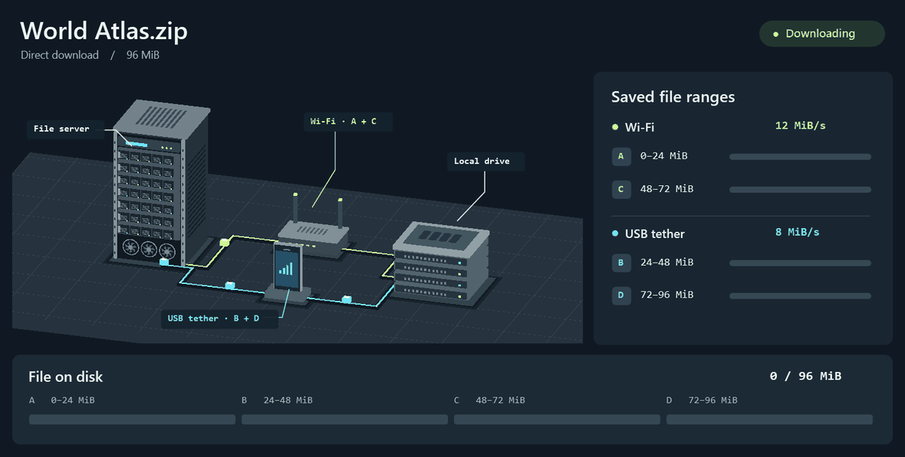

<div align="center">
  
  <h1>LinkFoundry</h1>
  <p><strong>Multiple connections. One download.</strong></p>
  <p>A Windows download manager that lets you watch real network traffic flow through a 3D server room.</p>
  <p><a href="#get-linkfoundry">Get LinkFoundry</a> · <a href="#your-first-download">Quick start</a> · <a href="#how-it-works">How it works</a> · <a href="#development">Development</a></p>
</div>



*Design preview with sample data. In the desktop app, the lights, ranges, and speed readings follow real transfer activity.*

LinkFoundry started with a practical problem: losing a connection halfway through a large download. It saves received bytes to disk, resumes compatible downloads after an interruption, and can assign different parts of a file to Wi-Fi, USB tethering, and Ethernet.

## Get LinkFoundry

**Platform:** Windows 10 or 11. The Windows x64 ZIP requires the **.NET 10 Desktop Runtime (x64)**. [Get the Desktop Runtime from Microsoft](https://dotnet.microsoft.com/en-us/download/dotnet/10.0).

### Run the Windows ZIP

1. Open [GitHub Releases](https://github.com/ArihantJainWebDev/LinkFoundry/releases) and download `PersonalDownloader-Windows-x64.zip` from **Assets** when available.
2. Right-click the ZIP and select **Extract All**.
3. Open the extracted folder and double-click **PersonalDownloader.Desktop.exe**. The executable still uses the original project name.

**Release status:** The source is on GitHub. A prebuilt ZIP has yet to be published there. Use the source instructions below to run the app today.

### Run from source today

Install the [.NET 10 SDK](https://dotnet.microsoft.com/en-us/download/dotnet/10.0) and Git, then run these commands in PowerShell.

```powershell
git clone https://github.com/ArihantJainWebDev/LinkFoundry.git
cd LinkFoundry
dotnet run --project Desktop/PersonalDownloader.Desktop.csproj
```

To create your own Windows ZIP from the checkout, run `.\Publish.ps1`. Find the generated archive in `release\`.

## Your first download

1. Paste a direct HTTP or HTTPS file link and select **Add download**.
2. Choose where to save it. LinkFoundry checks the server for the original filename, including links that redirect to an installer.
3. Open **Transfer room** to see the active routes, per-route speeds, and saved file ranges.
4. In **Library**, select a download to pause, resume, retry, or open its folder. Double-click a completed card, press **Enter**, or select **Open** to open the saved file. Opening an installer launches that installer.

### Use more than one connection

Connect your network devices in Windows. In the **Network rack**, select the adapters you want to use **before** adding a download. Leave every adapter unselected to let Windows route the connection automatically.

For a compatible large file, each adapter can carry different byte ranges. Unused paths stay dim, selected adapters are armed for new jobs, and packet motion follows measured transfer activity. With automatic routing, the app shows the adapter when it can identify it from the connection. Otherwise it displays **Windows route**.

Wi-Fi and USB tethering have been tested together on a physical laptop. A simultaneous Wi-Fi, tether, and Ethernet transfer is still pending physical validation. Connections that share an upstream router or provider can share the same bandwidth bottleneck.

### Send links from Chrome or Edge

1. Close the app and run `.\Install.ps1` from the extracted bundle or source checkout. It installs for your Windows account and registers the browser handoff.
2. Open Chrome or Edge’s extension manager, enable **Developer mode**, and choose **Load unpacked**.
3. Select the **Browser** folder printed by the installer.
4. Right-click a direct file link and select **Send link to Personal Downloader**, then choose a destination in the app.

The extension sends the URL. Cookie-protected downloads, blob links, POST-based downloads, and private launcher protocols may require the originating browser or app.

## How it works

| Stage | What LinkFoundry does |
| --- | --- |
| **Probe** | Requests byte zero and checks the server’s range response, final URL, size, and strong ETag. |
| **Download** | Splits a compatible file into up to four ranges. Workers stream bytes into separate files, using the selected adapters when available. |
| **Recover** | After an interruption, checks the remote version again and requests the missing bytes. A changed version starts fresh. |
| **Assemble** | Checks expected lengths, combines ranges in file order, and moves the completed result into place. An existing destination is protected. |

Servers without validated byte ranges and a strong ETag use one stream and restart interrupted transfers from zero. Multi-part assembly can temporarily need roughly twice the file size in free space. Queue records are saved under `%LOCALAPPDATA%\PersonalDownloader\Queue` and contain the original URLs.

## Development

LinkFoundry uses **C#**, **.NET 10**, and **WPF**. The 3D room uses WPF models and animates from the same progress counters that update the range bars.

| Directory | What’s inside |
| --- | --- |
| [Core](Core/) | HTTP streaming, adapter binding, queue persistence, and recovery |
| [Desktop](Desktop/) | Dashboard, network rack, 3D room, and download library |
| [Browser](Browser/) | Chrome and Edge context-menu extension |
| [Checks](Checks/) | Local HTTP integration checks for ranges, dropped connections, and recovery |
| [DesktopChecks](DesktopChecks/) | Windows UI checks for adapter selection, progress, and file opening |
| [design](design/) | WPF concept art and render scripts |

```powershell
dotnet run --project Checks -c Release
dotnet run --project DesktopChecks -c Release
node --test Checks/browser.test.cjs
```

The browser check requires Node.js. [Windows CI](https://github.com/ArihantJainWebDev/LinkFoundry/actions/workflows/windows-checks.yml) runs the checks and builds the desktop app.

## Feedback

[Open an issue](https://github.com/ArihantJainWebDev/LinkFoundry/issues) with your Windows version, adapter types, and steps to reproduce. For download problems, a public sample link that reproduces the behavior is more useful than a private or signed URL.
